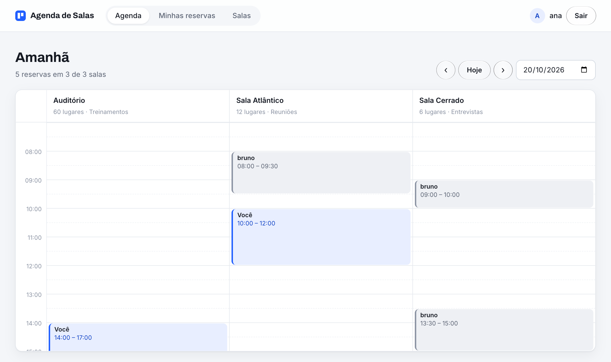

# Magazine API

API REST de **reserva de salas**, feita para o Desafio Backend da Magazine Luiza. Ela cuida de criar, editar e remover salas e de agendar horários nelas, **sem deixar dois agendamentos se chocarem**. Também tem login por token, filtros, um sistema de logs de tudo o que acontece e uma **tela web** para usar tudo isso sem precisar de Postman.

## Tecnologias

+ Python 3.12
+ Django 5.2 + Django REST Framework
+ Autenticação por Token (DRF)
+ SQLite
+ Pytest | 29 testes automatizados
+ HTML, CSS e JavaScript puros na tela web (sem Node e sem build)
+ CI com GitHub Actions
+ Bruno (coleção de requisições pronta)

## Rodando o projeto

    pip install -r requirements.txt
    python manage.py migrate
    python manage.py runserver

Depois abra **http://localhost:8000** no navegador.

E para rodar os testes:

    pytest

## Tela web

A pasta `Frontend` tem uma página única que o próprio Django serve em `/`. Ela só conversa com a API pelas rotas descritas abaixo.

+ **Entrar ou criar conta**: o token fica salvo no navegador e o botão Sair invalida o token na API
+ **Agenda**: as salas viram colunas e os horários, linhas (das 7h às 21h). Uma linha vermelha marca a hora atual. Para reservar, é só clicar num horário livre. As suas reservas aparecem em azul e as dos outros em cinza
+ **Conflito**: se o horário já estiver ocupado, a tela mostra o erro que a API devolveu, diz quem reservou antes e destaca na agenda a reserva que bateu
+ **Minhas reservas**: as próximas reservas aparecem primeiro e cada uma pode ser editada ou cancelada
+ **Salas**: cadastrar, editar e remover salas

Os horários seguem o fuso de Brasília (`America/Sao_Paulo`), inclusive no filtro `?date=` da API.

## Autenticação

Cadastre-se ou faça login para receber um token. Mande esse token no header das rotas que alteram dados:

    Authorization: Token seu_token_aqui

Quem não está logado pode **consultar** salas e agendamentos, mas não pode criar, editar nem remover nada.

| Método | Rota | O que faz |
|---|---|---|
| POST | `/api/auth/cadaster/` | Cria a conta e devolve o token |
| POST | `/api/auth/login/` | Devolve o token |
| POST | `/api/auth/logout/` | Invalida o token |

    {
        "username": "your_username",
        "email": "you@example.com",
        "password": "your_password"
    }

## Salas

| Método | Rota | O que faz |
|---|---|---|
| GET | `/api/rooms/` | Lista as salas |
| POST | `/api/rooms/create/` | Cria uma sala |
| PATCH/PUT | `/api/rooms/edit/<id>/` | Edita uma sala |
| DELETE | `/api/rooms/delete/<id>/` | Remove uma sala (e os agendamentos dela) |

    {
        "name": "Sala 1",
        "capacity": 20,
        "objective": "Reuniões"
    }

O nome da sala é único e a capacidade precisa ser maior que zero.

## Agendamentos

| Método | Rota | O que faz |
|---|---|---|
| GET | `/api/schedules/` | Lista os agendamentos, com filtros opcionais |
| POST | `/api/schedules/create/` | Agenda uma sala |
| PATCH/PUT | `/api/schedules/edit/<id>/` | Edita um agendamento (só quem criou) |
| DELETE | `/api/schedules/remove/<id>/` | Remove um agendamento (só quem criou) |

    {
        "room": 1,
        "start_time": "2026-01-10T15:00:00Z",
        "end_time": "2026-01-10T16:00:00Z"
    }

O agendamento fica no nome do usuário logado. A API recusa:
+ horário de término antes do início;
+ qualquer sobreposição com outro agendamento da mesma sala: começar no meio, terminar no meio, ficar dentro ou englobar. Horários que só se encostam (um termina às 16h e o outro começa às 16h) são permitidos.

**Filtros da listagem:** `?room=<id>`, `?date=AAAA-MM-DD` e `?mine=true` (só os seus). Dá para combinar, por exemplo `/api/schedules/?room=1&date=2026-01-10`.

## Filtering

Uma API separada para busca e listagem, pensada para que novas tabelas ganhem filtragem sem precisar mexer nas outras apps.

| Método | Rota | O que faz |
|---|---|---|
| GET | `/api/list/rooms/` ou `/api/list/schedules/` | Lista a tabela inteira |
| GET | `/api/filter/rooms/<nome da sala>/` | Busca uma sala pelo nome |
| GET | `/api/filter/schedules/<nome da sala>/` | Lista os agendamentos dessa sala |

## Logs

Toda criação, edição e remoção fica registrada na tabela `Log`. As mensagens ficam centralizadas no dicionário `LOGS_MESSAGES` (em `Logs/logs.py`), então todos os logs seguem o mesmo padrão, e adicionar um log novo é só incluir uma chave nele:

    logger("success_room_create", none_room=room.name)

## Testando com o Bruno

A pasta `MagazineAPI_JSON_tests` é uma coleção do [Bruno](https://www.usebruno.com), com todas as rotas prontas. Abra a pasta no Bruno, faça login e coloque o token recebido na variável `token`.
